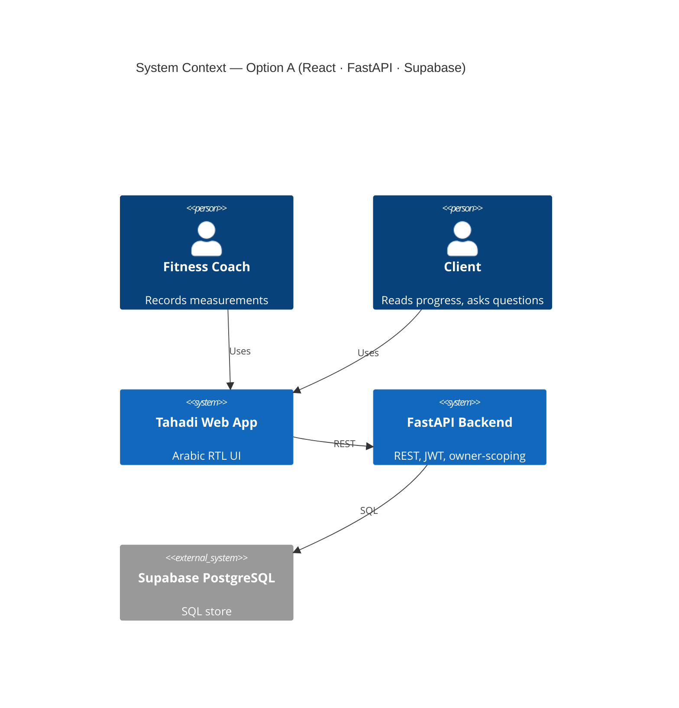
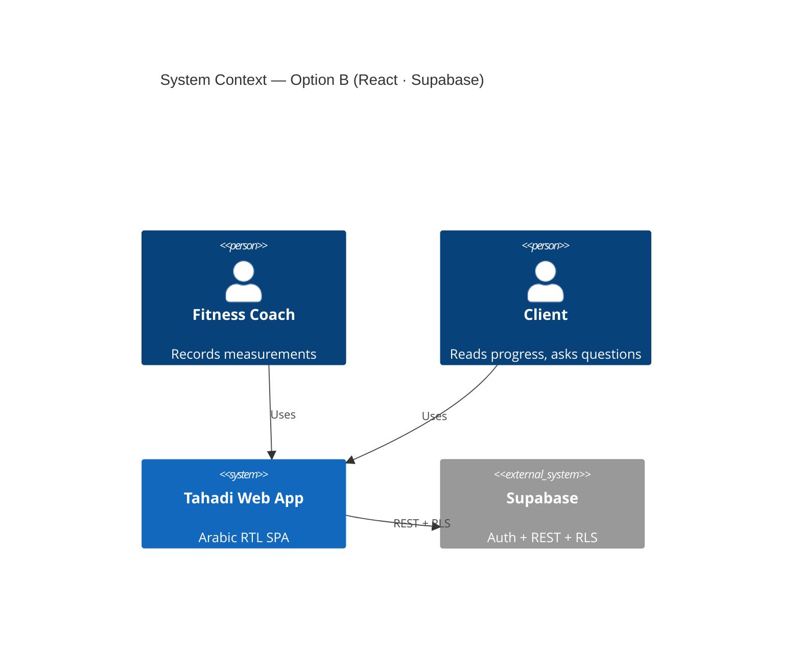
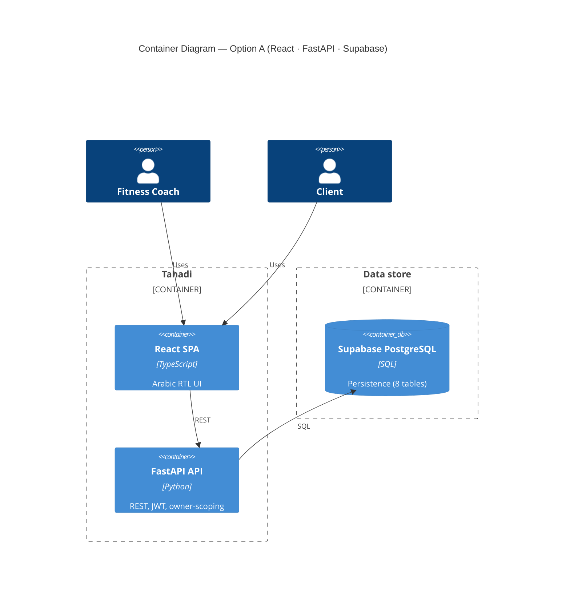
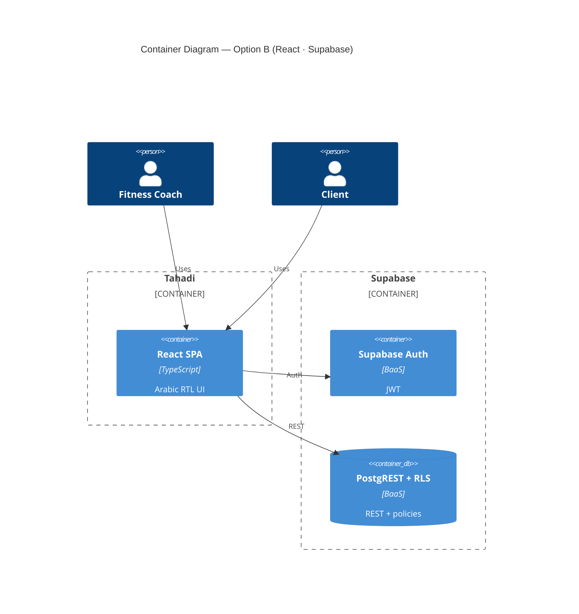

# Architecture — Tahadi (تحدي)

## Document control

| Field | Value |
| --- | --- |
| Version | 0.1.0 |
| Status | Draft — Milestone 1 |
| Date | 2026-10-21 |
| Related spec | `docs/specs/SPEC-architecture.md` |
| Source | `README.md`, `CHARTER.md`, `docs/requirements/requirements.md` |

> This document describes two genuinely distinct architecture options for Tahadi,
> draws the C4 Context and Container diagram for each, checks coupling, and records
> the decision. The full comparison lives in
> `docs/architecture/trade-off-matrix-architecture.md` and the cost in
> `docs/architecture/cost-model.md`; the decisions are recorded as ADRs in
> `docs/adr/`.

---

## 1. Decision context

Tahadi is an Arabic-first, RTL web app for fitness coaches and their clients.
Coaches record client body measurements (weight, waist, skinfolds) and reply to
client questions; clients log in and view **only their own** progress (read-only)
and ask their coach a question.

The architecture must support:

* **Roles:** exactly two — `coach` and `client`. No admin role.
* **Screens:** ≤6 (auth, coach client list, coach client detail, coach threads,
  client progress, client thread).
* **API endpoints:** ≤10.
* **Database tables:** ≤8.
* **Deployment:** two targets since ADR-0009 (Vercel frontend, Render backend), with Supabase PostgreSQL as the store.
* **Auth:** stateless JWT validated by the backend. **Supabase is used only as a
  SQL database** — no Supabase Auth, Storage, Realtime, or Edge Functions
  (see `README.md` and `requirements.md` §8).
* **Non-goals:** payments, workout/nutrition plans, medical advice, native mobile,
  real-time chat, photo upload (see `CHARTER.md`).

### Scope caps (hard constraints)

| Dimension | Cap |
| --- | --- |
| Screens | 6 |
| API endpoints | 10 |
| Database tables | 8 |
| Roles | 2 |
| Deployment targets | 2 (raised from 1 by ADR-0009) |

---

## 2. The two options

### Option A — React → FastAPI → Supabase (chosen)

A three-tier architecture. A React/TypeScript single-page app talks to a FastAPI
backend over HTTPS/JSON. FastAPI owns the business logic, JWT auth, and
owner-scoping rules, and talks to Supabase PostgreSQL over a pooled SQL
connection. Supabase is the managed SQL store only.

* **Where each concern lives:** presentation (React), logic + auth + authorization
  (FastAPI), persistence (Supabase PostgreSQL).
* **Frontend:** React SPA, `dir="rtl"`, `lang="ar"`.
* **Backend:** FastAPI (Python 3.12), Pydantic models, OpenAPI docs.
* **Data:** Supabase PostgreSQL (managed, external), used as SQL only.

### Option B — React → Supabase directly (rejected)

A two-tier architecture. The React SPA talks directly to Supabase, which provides
the auto-generated REST/GRPC API (PostgREST), Supabase Auth, and its Row Level
Security policies as the authorization layer. There is no separate backend; all
business rules live in Postgres policies and the client.

* **Where each concern lives:** presentation (React), logic + auth + authorization +
  persistence (Supabase: PostgREST + Auth + RLS).

---

## 3. C4 Context diagrams

> Deployment host **Render** is intentionally not drawn as a node so the layout stays
> free of crossing lines and unreadable labels; see the "Deploy on Render" rows in §6.
> The `Rel_R` / `Rel_D` directives guide the layout so no arrow passes through a box.

### Option A — System Context

### Option B — System Context

---

## 4. C4 Container diagrams

### Option A — Containers

### Option B — Containers

---

## 5. Coupling check

The two options are genuinely distinct: Option A is **three-tier** with an
application server in the middle; Option B is **two-tier** where the browser talks
straight to a BaaS. They differ in where business logic, authorization, and schema
ownership live.

**Coupling analysis (Option A, chosen):**

* FastAPI is the single coupling point for the backend concerns. The React SPA
  depends on the FastAPI contract; FastAPI depends on the Supabase schema.
* The frontend is decoupled from the database schema — it never issues SQL, so a
  schema change that keeps the API contract stable does not require a frontend
  change (satisfies NFR-6, "adding a metric touches ≤2 files").
* **Accepted coupling cost:** FastAPI and Supabase each become a hard dependency of
  the path a request travels. If the API is down, the whole flow is down (no
  client-direct fallback), and we must keep two services alive on Render.

**Coupling analysis (Option B, rejected):**

* The React SPA is coupled directly to the database schema and to Supabase
  semantics (PostgREST query shapes, RLS policy behaviour, Supabase Auth tokens).
* Business rules that belong in one place (e.g. "a client may only write when a
  coach has assigned them", FR-8/FR-12) must be expressed as RLS policies or client
  logic, which is harder to test and to explain in an academic context, and risks
  splitting a single business rule across the client and Postgres.

### Residual risk the coupling detector cannot reveal

A static coupling check sees the *topology* (which component calls which) but not the
*runtime data-flow invariant* central to this system: that every measurement and
message is scoped to the logged-in owner, and that a client never sees another
client's rows even when an endpoint is reachable. This invariant is enforced by
owner-scoping logic inside FastAPI (ADR-0003), not by the component diagram, so a
coupling detector cannot flag it. It is a residual risk specific to Tahadi: the
*client-side* never touches other users' data because of rules in the *backend*, and
only end-to-end tests that attempt cross-owner reads (NFR-3) can prove it holds.
A second residual risk: Option A depends on the **single Supabase shared PostgreSQL
instance** being reachable and within its free-tier limits; because the frontend has
no offline route, any DB pause/limit surfaces directly to the user during a demo.

---

## 6. Trade-offs and decision

| | Option A | Option B |
| --- | --- | --- |
| **Layers** | 3 (React · FastAPI · Supabase) | 2 (React · Supabase) |
| **Where auth lives** | FastAPI (JWT) | Supabase Auth |
| **Where authorization lives** | FastAPI owner-scoping | Supabase RLS + client |
| **Deploy on Render** | Frontend + backend (2 services) | Frontend only |
| **Coupling to schema** | Backend only | Client + Postgres |
| **Testability / explainability** | High (server tests) | Lower (RLS + client logic) |

**Decision: Option A.** It centralizes auth, authorization, and business logic in an
API the team controls and can unit-test and explain, keeps the frontend decoupled
from the schema, and stays on a single deployment target. The full weighted
comparison is in `trade-off-matrix-architecture.md`; the cost is in `cost-model.md`.
Recorded in **ADR-0001**.

---

## 7. Related documents

* `docs/architecture/trade-off-matrix-architecture.md` — weighted comparison.
* `docs/architecture/cost-model.md` — monthly cost with published rates.
* `docs/adr/ADR-0001-*.md` — choose Option A over Option B.
* `docs/adr/ADR-0002-*.md` — backend JWT auth (not Supabase Auth).
* `docs/adr/ADR-0003-*.md` — owner-scoped access + client read-only.
* `docs/traceability-matrix.md` — requirement → ADR → risk links.
